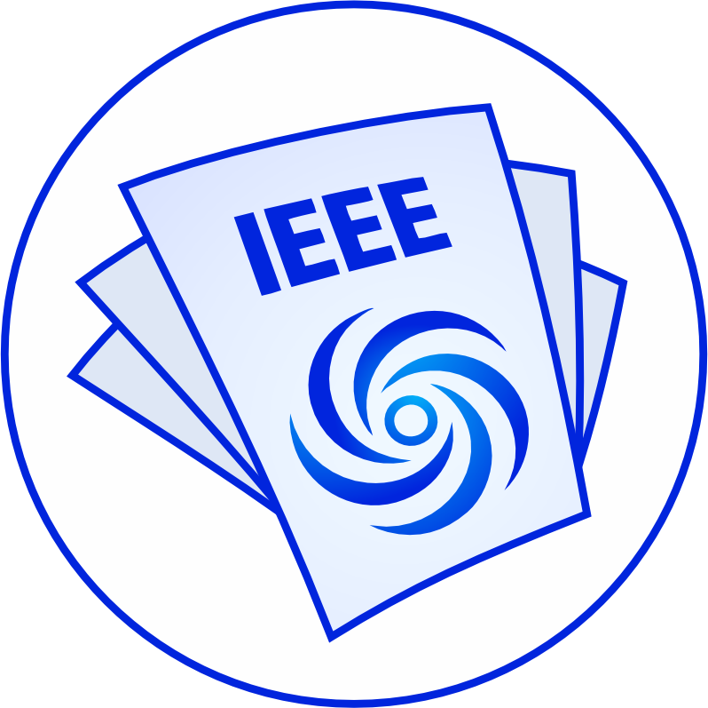
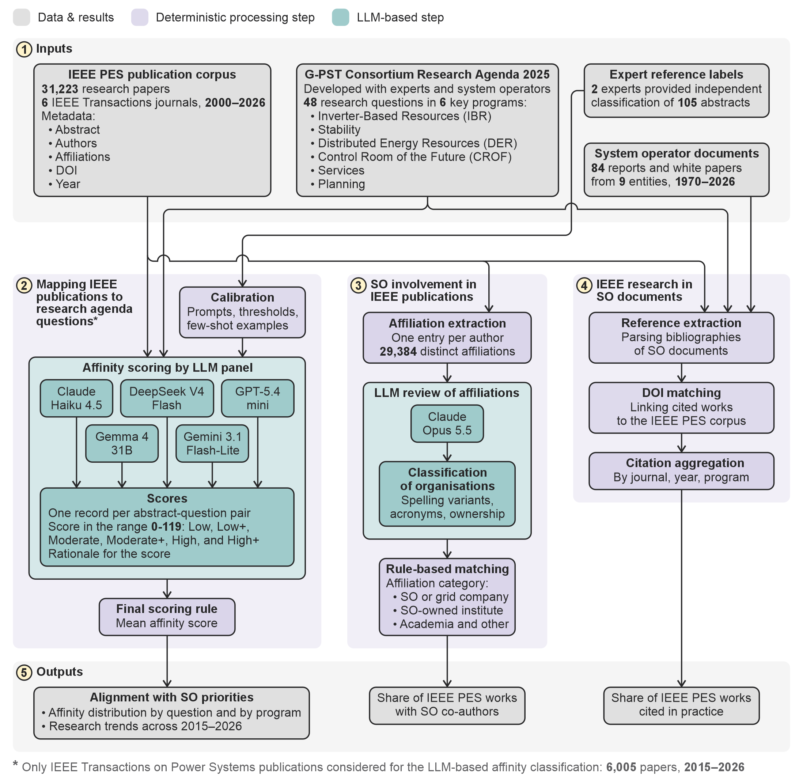
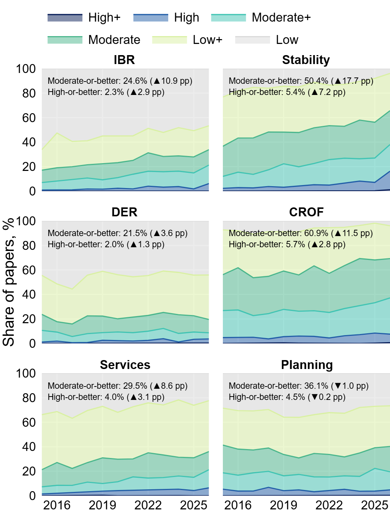
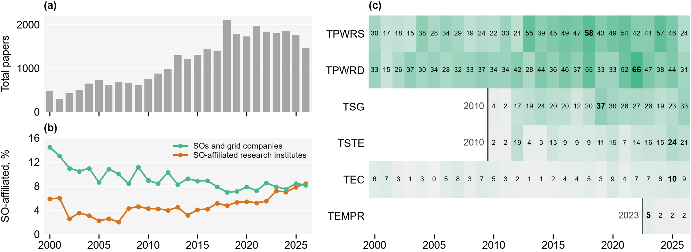

  

# Article Classifier Suite

Code and data for the paper *"Does Power System Research Address Industry Needs? LLM-Based
Analysis of IEEE Publications, 2000–2026"*.

....

## Methodology

  

The inputs (1) include the IEEE PES publications, the SO research priority questions, expert
reference labels, and SO documents. Three complementary analyses follow. In the alignment
analysis (2), a panel of five LLMs scores the affinity between publication abstracts and the
48 research questions. The SO involvement analysis (3) matches author affiliations against
LLM-curated reference lists of SOs, grid companies, and SO-owned research institutes. The
uptake analysis (4) matches references in SO documents to the IEEE PES corpus. The outputs (5)
show how well IEEE research aligns with operator priorities, how often operators help write
it, and how often they cite it. Steps performed by LLMs are shown in teal.

## Projects

| Folder | What it does | Status |
|---|---|---|
| [`article-alignment-classifier/`](article-alignment-classifier/) | Scores IEEE abstracts against the Research Agenda questions and programmes with an ensemble of LLMs | .... |
| [`SO-involvement-in-authorship/`](SO-involvement-in-authorship/) | Finds papers with authors from system operators, grid companies and their research institutes | .... |
| [`academy-uptake/`](academy-uptake/) | .... | .... |

## Data

....

## Getting started

....

## Results

....

  

Alignment of IEEE Transactions on Power Systems papers (2015–2026) with the six research
programmes: share of papers per year at each affinity level, Low to High+. See
[`article-alignment-classifier/`](article-alignment-classifier/).

  

SO involvement in IEEE PES publications: (a) research papers per year, (b) share of papers with
at least one author from an SO or grid company, or from an SO-owned research institute,
(c) papers with an SO or grid-company author by journal and year. See
[`SO-involvement-in-authorship/`](SO-involvement-in-authorship/).

## Citation

....

## Authors and acknowledgements

....

## License

....
