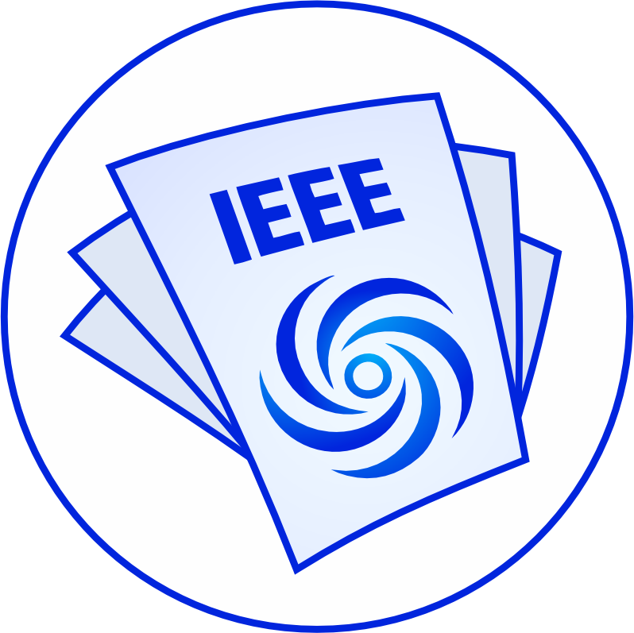

<p align="center">
  
</p>

# SO involvement in authorship

Part of the article-classifier-suite, for the paper *"Does Power System Research Address Industry Needs? LLM-Based
Analysis of IEEE Publications, 2000–2026"*.

This project finds which papers in six IEEE Transactions (TPWRS, TPWRD, TSG, TSTE, TEC, TEMPR) 
have at least one author working at a system operator (SO), a grid company, or a
research institute owned by SO. It does this by matching each author affiliation against
curated reference lists of organisations.

## How it works

1. **Reference lists** (`data/reference/`) give one regular expression per organisation or group
   of organisations, with its type, parent and country. The lists were built and reviewed in
   rounds with an LLM (Claude Opus 5.5): unmatched affiliations were reviewed, organisations were
   added, and the matches were checked for false positives. Each decision is one row in a
   CSV, so it can be read and changed.
2. **Matching** is rule-based and deterministic. No LLM is called when the scripts run. Each
   affiliation gets one of these types:

   | Type | Meaning | Examples |
   |---|---|---|
   | `TSO` | transmission or independent system operator, RTO | MISO, ERCOT, RTE, TenneT, AEMO |
   | `GRIDCO` | state-owned or vertically integrated grid company | State Grid, CSG, Hydro-Québec, BPA, KEPCO |
   | `DSO` | distribution network operator or utility | Enedis, UK Power Networks, Con Edison |
   | `RESEARCH` | research institute owned by one of the above | CEPRI, IREQ, NARI, KEPRI, CEPEL |

   A paper is `SO_DIRECT` if any author is `TSO`, `GRIDCO` or `DSO`, and `HAS_SO` if it is
   direct or `RESEARCH`. Not counted: independent research bodies (EPRI, national labs),
   regulators, power exchanges, generation-only companies, vendors, and university chairs funded
   by utilities. Some organisations are flagged `borderline` (e.g. EDF, Enel, WECC), so results
   can be shown without them.
3. **Paper filter.** Front matter, discussions and closures, corrections, editorials and award
   lists are excluded (`IS_PAPER = 0`), and so are papers without affiliations
   (`HAS_AFFILIATIONS = 0`). This leaves 31,223 research papers out of 34,213 records.

## How to run

Requirements are Python 3.11 and the packages in `requirements.txt`. From this folder:

```
pip install -r requirements.txt
python scripts/03_classify_papers.py      # -> results/so_classification.csv
python scripts/04_top_organisations.py    # -> results/top_organisations/*.csv   (~2-3 min)
python scripts/05_plot_figure.py          # -> results/figures/SO_involvement.pdf/.png
```

Steps 1 and 2 are only needed to extend the reference lists. They write review lists to
`results/review/` (not versioned): `01_extract_affiliations.py` lists every distinct
affiliation, and `02_find_candidates.py` lists the affiliations the lists do not yet cover.

The figure uses Arial, as in the paper. On systems without Arial, matplotlib falls back to its
default font.

## Contents

```
data/ieee_papers.csv              input: doi, title, authors, affiliations, journal, year
data/reference/
  so_organisations.csv            SOs, grid companies and their research institutes (135 entries)
  excluded_organisations.csv      organisations reviewed and rejected; mask = 1 rows are blanked out before matching
  research_institute_names.csv    name aliases for research institutes (step 4 only)
  university_names.csv            name aliases for the top universities (step 4 only)
  company_names.csv               name aliases for companies within group entries (step 4 only)
src/so_matching.py                paths, loading and the affiliation matcher
scripts/01-05_*.py                the steps above
results/so_classification.csv     one row per DOI: paper filter, SO flags by type, matched organisations and evidence
results/top_organisations/        papers per SO, research institute (by owner and by institute) and university;
                                  *_variants.csv list the spellings merged into each name
results/figures/                  the figure in the paper
```

`data/ieee_papers.csv` comes from the IEEE Xplore exports in
`../article-alignment-classifier/data/raw/*_ieee.csv`, with abstracts and other columns
removed. It leaves out 37 TPWRS 2026 Early Access papers that were added to those exports
after this analysis was run.

## Limitations

- Facts about organisations (ownership of institutes, which utilities own transmission) come
  from the LLM-assisted review and were not checked against external sources.
- An unfamiliar grid company that appears only once, and whose affiliation contains no
  grid-related words, may be missed.
- In `results/top_organisations/`, spellings are merged by the alias lists and by a
  normalised name (accents, case, punctuation ignored). The alias lists were reviewed for the
  top 50 universities and companies. Further down the tables, a name written in two
  substantially different ways (e.g. as an abbreviation) can still appear twice. Separate
  campuses of a university system (e.g. UC Berkeley, UC San Diego) and institutions that later
  merged are kept separate; branch campuses of one university are merged.
