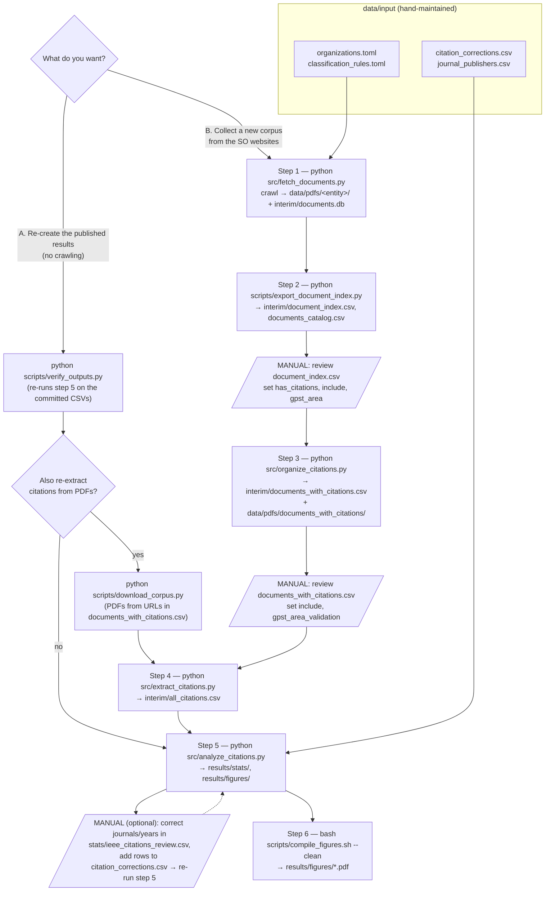

# SO-involvement

How often do power-system organizations — system operators (TSOs/ISOs/RTOs),
research consortia (ESIG, G-PST) and vendors — cite IEEE PES Transactions in
the technical reports they publish, broken down by the six G-PST Research
Agenda 2025 areas (IBRs, Stability, DER, CROF, Services, Planning)?

This folder contains the pipeline that crawls the organizations' websites,
triages and curates the PDFs, extracts every reference, classifies it
(IEEE PES Transactions / other journal / conference / other) and produces the
statistics, tables and figures.

## Folder layout

```
SO-involvement/
├── environment.yml          conda environment (python 3.11)
├── src/                     pipeline code
│   ├── paths.py               every path used by the pipeline (one place)
│   ├── fetch_documents.py     1. crawl sites, download & triage PDFs → documents.db
│   ├── organize_citations.py  3. copy has_citations=yes PDFs, build documents_with_citations.csv
│   ├── extract_citations.py   4. parse reference lists → all_citations.csv
│   ├── analyze_citations.py   5. corrections, stats, PNG figures, .tex tables
│   └── tikz_export.py            (called by 5) standalone pgfplots .tex figures
├── scripts/                 helpers and utilities
│   ├── export_document_index.py  2. documents.db → document_index.csv (+ documents_catalog.csv)
│   ├── download_corpus.py        re-download the curated PDFs from their stored URLs
│   ├── compile_figures.sh        6. pdflatex every figure .tex
│   └── verify_outputs.py         check that the committed results are reproduced exactly
└── data/
    ├── input/               hand-maintained configuration and corrections
    ├── interim/             document index, curated document list, extracted citations
    ├── results/
    │   ├── stats/           CSV / JSON / .tex tables  (some files are manual inputs, see below)
    │   └── figures/         PNG figures + standalone .tex (pgfplots) figures
    └── pdfs/                downloaded PDFs — git-ignored, re-creatable
```

All scripts resolve paths from `src/paths.py`, so they can be run from any
directory. Setting `SO_DATA_DIR=/some/folder` redirects the whole pipeline to a
different data folder (useful for test runs that must not touch `data/`).

## Setup

```bash
conda env create -f environment.yml
conda activate so-involvement
playwright install chromium     # one-time; needed only by fetch_documents.py
```

`scripts/compile_figures.sh` additionally needs a TeX distribution with
`pdflatex`, `standalone` and `pgfplots` (TeX Live / MacTeX).

## How to run



### A. Re-create the published results

The committed CSVs in `data/interim/` and the curated files in
`data/results/stats/` are everything the analysis needs, so the fastest check
is:

```bash
python scripts/verify_outputs.py      # re-runs analyze_citations.py in a temp copy
bash scripts/compile_figures.sh --clean
```

`verify_outputs.py` copies `data/` to a temporary folder, re-runs
`analyze_citations.py` there and compares all 116 stats and figure files
byte-for-byte with the committed ones. It prints `[OK] results reproduced
exactly.` when nothing differs.

To go back one step further and re-extract the citations from the PDFs:

```bash
python scripts/download_corpus.py          # ~140 PDFs into data/pdfs/documents_with_citations/
python src/extract_citations.py --overwrite
python src/analyze_citations.py
bash scripts/compile_figures.sh --clean
```

Re-running `extract_citations.py --overwrite` on the original PDFs reproduces
`all_citations.csv` byte-for-byte (1,666 citations). When the PDFs come from
`download_corpus.py` instead, see *URL drift* below.

### B. Collect a new corpus from the SO websites

```bash
python src/fetch_documents.py                          # all organizations (hours)
python src/fetch_documents.py --entities ercot g-pst   # or a subset (keys in organizations.toml)
python src/fetch_documents.py --entities-file data/input/fetch_targets.txt
python scripts/export_document_index.py
#   → review data/interim/document_index.csv (has_citations / include / gpst_area)
python src/organize_citations.py
#   → review data/interim/documents_with_citations.csv (include / gpst_area_validation)
python src/extract_citations.py
python src/analyze_citations.py
bash scripts/compile_figures.sh --clean
```

Notes:

* `fetch_documents.py` skips URLs already in `documents.db`, so it can be
  re-run to resume or extend a crawl. Pages marked with a third element `true`
  in `organizations.toml` are rendered with headless Chromium (Playwright).
* Websites change: a new crawl will find a different set of documents than the
  committed corpus. Use path A to reproduce the published numbers.
* `export_document_index.py` and `organize_citations.py` never overwrite your
  manual edits; they merge new documents into the existing CSVs.
* `extract_citations.py` only processes PDFs not yet in `all_citations.csv`;
  pass `--overwrite` to re-extract everything.
* If `gpst_area_validation` is left empty, the auto-guessed `gpst_area` is used.

## Data files

### `data/input/` — hand-maintained

| File | Used by | Contents |
|---|---|---|
| `organizations.toml` | fetch | Organization registry: name, region, crawl pages (`[url, max_pages, use_browser]`), seed PDFs |
| `classification_rules.toml` | fetch | Regex rules that auto-guess the G-PST area of a document |
| `fetch_targets.txt` | fetch (`--entities-file`) | Optional list of organization keys to crawl |
| `citation_corrections.csv` | analyze | Manual per-citation fixes: real journal name, `remove` (not a citation), `IEEE conference` |
| `journal_publishers.csv` | analyze | Journal → publisher → link lookup |

### `data/interim/` — pipeline intermediates (with links, no PDFs)

| File | Written by | Contents |
|---|---|---|
| `documents_catalog.csv` | export_document_index | Every URL the crawl discovered (13,326), whether it was kept, triage flags |
| `document_index.csv` | export_document_index, **then edited by hand** | Kept PDFs with `has_citations`, `include`, `gpst_area`, `notes` |
| `documents_with_citations.csv` | organize_citations, **then edited by hand** | **The curated corpus.** `include=yes` rows (143) are analysed; `gpst_area_validation` holds the reviewed G-PST area(s) |
| `all_citations.csv` | extract_citations | One row per reference: document, URL, reference text, `ref_type`, `is_ieee_transactions` |

### `data/results/stats/` — outputs **and manual inputs**

Most files here are regenerated on every run, but these are hand-curated and
are **read back** by `analyze_citations.py` — do not delete them:

| File | Behaviour |
|---|---|
| `ieee_citations_review.csv` | Regenerated each run, but your `journal`, `pub_year` and `exclude` edits are kept and applied to all stats |
| `unresolved_other_journals*.csv` | Regenerated each run, keeping your `journal`/`publisher` entries (copy finished rows into `citation_corrections.csv`) |
| `journal_citations_by_document_system_operators.csv` | Written once, then kept as-is (manually curated) |
| `system_operators_documents_with_citations.csv` | Written once, then kept as-is (manually curated) |

Three analysis scopes are produced, distinguished by file suffix: *(none)* =
all entities, `_no_esig` = without ESIG, `_system_operators` = TSOs/ISOs/RTOs
only (vendors, consortia and NERC excluded).

### `data/results/figures/`

`gpst_*.png` are matplotlib figures (900 dpi, IEEE column widths).
`gpst_*.tex` are standalone pgfplots versions of the corpus-level figures;
each compiles on its own to a tightly-cropped PDF (`compile_figures.sh`).

The table fragments in `stats/*.tex` are meant to be `\input` into a paper
whose preamble loads:

```latex
\usepackage{booktabs,longtable,array,graphicx,url,hyperref}
```

(`longtable` tables must be placed in one-column mode.)

## Known limitations

* **URL drift.** PDFs are not stored in the repository. As of 2026-10-24 all
  143 curated URLs still download; 139 are byte-identical to the originals and
  4 have been replaced by their publishers (`ESIG-Grid-Enhancing-Technologies-report-2025.pdf`,
  `ESIG-Retail-Pricing-dynamic-rates-E3-wp-2023.pdf`, PJM `m22-redline.pdf`,
  RTE `2025-03-resume-executif-benchmark.pdf`), so citations re-extracted from
  those can differ. Failed downloads are listed in `data/pdfs/download_failures.csv`.
  The committed `all_citations.csv` is the reference extraction.
* **36 PJM documents excluded.** They were marked `include=yes` but their PDFs
  were never retained locally and none contributed citations (most were
  already confirmed as false positives). They are set to `include=no` with a
  note, so the curated CSV matches the published results.
* `summary.json` → `total_docs` counts included documents (143);
  per-entity `docs` counts only documents that contributed ≥ 1 citation.
* Two pgfplots figures (`gpst_all_entities_no_esig.tex`,
  `gpst_all_entities_system_operators.tex`) emit a harmless "axis range is
  empty" warning for a panel with no data in that scope.
